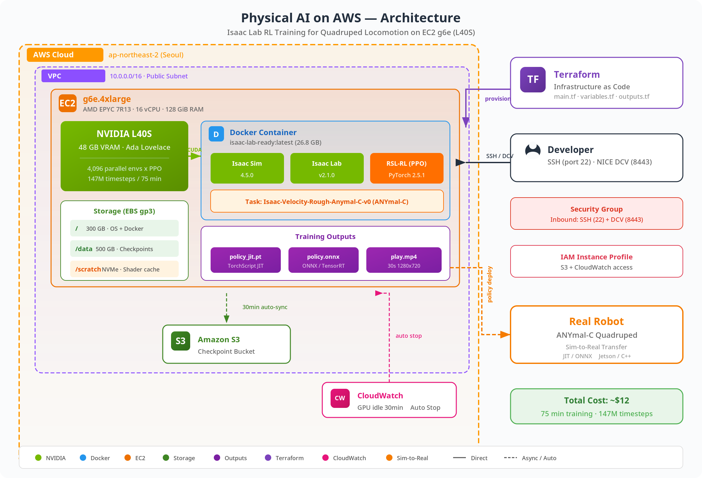
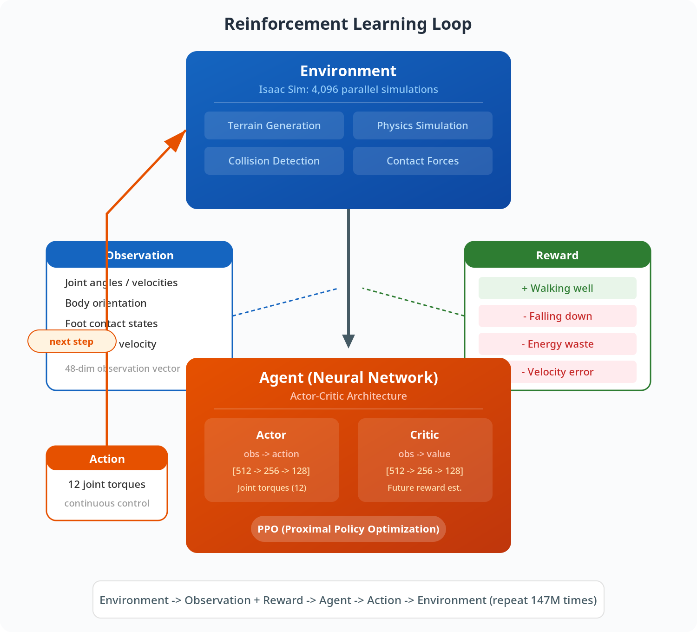

# Physical AI 실전 가이드: AWS에서 로봇 강화학습 처음부터 끝까지

> Isaac Lab + PPO로 4족 보행 로봇(Anymal-C)이 거친 지형에서 걷는 법을 학습하는 전체 과정

***

## 목차

1. [Physical AI란 무엇인가?](REPORT_Physical_AI_on_AWS.md#1-physical-ai란-무엇인가)
2. [왜 클라우드(AWS)인가?](REPORT_Physical_AI_on_AWS.md#2-왜-클라우드aws인가)
3. [전체 아키텍처](REPORT_Physical_AI_on_AWS.md#3-전체-아키텍처)
4. [Step 1: AWS 인프라 구축 (Terraform)](REPORT_Physical_AI_on_AWS.md#4-step-1-aws-인프라-구축-terraform)
5. [Step 2: Isaac Lab 환경 구축 (Docker)](REPORT_Physical_AI_on_AWS.md#5-step-2-isaac-lab-환경-구축-docker)
6. [Step 3: 강화학습 훈련 실행](REPORT_Physical_AI_on_AWS.md#6-step-3-강화학습-훈련-실행)
7. [Step 4: 학습 결과 분석](REPORT_Physical_AI_on_AWS.md#7-step-4-학습-결과-분석)
8. [삽질 기록: 실전에서 만난 12가지 함정](REPORT_Physical_AI_on_AWS.md#8-삽질-기록-실전에서-만난-12가지-함정)
9. [비용 분석](REPORT_Physical_AI_on_AWS.md#9-비용-분석)
10. [다음 단계](REPORT_Physical_AI_on_AWS.md#10-다음-단계)

***

## 1. Physical AI란 무엇인가?

Physical AI는 물리 세계에서 동작하는 인공지능입니다. 자율주행차, 로봇 팔, 보행 로봇, 드론 등이 여기에 해당합니다.

기존 AI(ChatGPT, 이미지 생성 등)와의 결정적 차이:

```
기존 AI: 텍스트/이미지 입력 → 텍스트/이미지 출력
         (실패해도 물리적 피해 없음)

Physical AI: 센서 입력 → 모터 제어 출력
            (실패 = 로봇 파손, 사람 부상 가능)
```

이 때문에 시뮬레이션이 핵심입니다. 실제 로봇으로 시행착오를 겪는 대신, 가상 환경에서 수만 번 실패해도 아무도 다치지 않습니다.

### 이번 실습에서 한 일

ANYmal-C 4족 보행 로봇을 거친 지형(바위, 경사면, 계단)에서 걷게 만들었습니다.

```
목표: "앞으로 걸어" 라는 속도 명령을 줬을 때, 넘어지지 않고 정확하게 따라가는 보행 정책 학습

방법: 강화학습(Reinforcement Learning)
     - 잘 걸으면 +보상
     - 넘어지면 -패널티
     - 이걸 수백만 번 반복 → 최적의 보행 패턴 발견
```

***

## 2. 왜 클라우드(AWS)인가?

### 로컬 PC의 한계

| 항목                      | 게이밍 PC (RTX 4090)   | AWS g6e.4xlarge (L40S) |
| ----------------------- | ------------------- | ---------------------- |
| VRAM                    | 24 GB               | 48 GB                  |
| 동시 시뮬레이션 환경 수           | \~2,048             | \~4,096+               |
| 학습 시간 (1500 iter)       | \~2.5시간             | \~75분                  |
| Isaac Sim Docker 이미지 크기 | 22.6 GB (로컬 디스크 부담) | EBS에서 자유롭게 확장          |
| 비용                      | GPU 구매 \~$2,000+    | 시간당 \~$3.00 (쓴 만큼만)    |

### 핵심 이점

1. 스케일 업/다운 자유: 실험은 g6e.xlarge($1/hr), 본격 훈련은 g6e.12xlarge(4x GPU)
2. Spot 인스턴스: 같은 GPU를 60-70% 할인 (체크포인트 기반 복구로 중단 대응)
3. 팀 협업: S3에 체크포인트 공유, 여러 실험 동시 실행
4. 재현성: Terraform으로 환경을 코드로 관리 → 누구나 동일 환경 재현

***

## 3. 전체 아키텍처



***

## 4. Step 1: AWS 인프라 구축 (Terraform)

### Terraform이란?

인프라를 코드로 정의하는 도구입니다. AWS 콘솔에서 클릭 대신, 코드로 작성하면:

* 재현 가능: 같은 코드로 누구나 동일 환경 생성
* 버전 관리: Git으로 인프라 변경 이력 추적
* 일괄 삭제: `terraform destroy` 한 줄로 모든 리소스 정리 (과금 방지)

### 파일 구조

```
pai-sim-isaaclab/
├── main.tf           # 핵심: VPC, EC2, EBS, IAM, CloudWatch 정의
├── variables.tf      # 입력 변수 (리전, 인스턴스 타입, 키 이름 등)
├── outputs.tf        # 출력 (SSH 명령어, IP 주소 등)
├── terraform.tfvars  # 실제 값 (API 키, 리전 등 — gitignore 대상)
└── user_data.sh      # EC2 부팅 시 자동 실행되는 설치 스크립트
```

### 주요 리소스

```hcl
# 1. AMI 선택 — NVIDIA 드라이버가 이미 설치된 Deep Learning AMI
data "aws_ami" "dl_base" {
  most_recent = true
  owners      = ["amazon"]
  filter {
    name   = "name"
    values = ["Deep Learning Base OSS Nvidia Driver GPU AMI (Ubuntu 22.04) *"]
  }
}

# 2. GPU 인스턴스 — L40S 48GB
resource "aws_instance" "isaac" {
  ami           = data.aws_ami.dl_base.id
  instance_type = "g6e.4xlarge"       # 1x L40S, 16 vCPU, 128 GiB RAM

  root_block_device {
    volume_size = 300                  # Isaac Sim(23GB) + Lab(25GB) + 여유
    volume_type = "gp3"
  }

  user_data = base64encode(templatefile("user_data.sh", {
    ngc_api_key       = var.ngc_api_key
    isaac_sim_version = "4.5.0"
    isaac_lab_version = "v2.1.0"
  }))
}

# 3. 데이터 볼륨 — 체크포인트 저장 (인스턴스 삭제해도 유지)
resource "aws_ebs_volume" "data" {
  size = 500
  type = "gp3"
}

# 4. 비용 절약 — GPU 유휴 30분 시 자동 중지
resource "aws_cloudwatch_metric_alarm" "gpu_idle" {
  alarm_actions = ["arn:aws:automate:${var.aws_region}:ec2:stop"]
  threshold     = 5                    # GPU 사용률 5% 미만
  period        = 300                  # 5분 간격 체크
  evaluation_periods = 6               # 6회 연속 = 30분
}
```

### 실행

```bash
terraform init      # 프로바이더 다운로드
terraform plan      # 변경 사항 미리보기
terraform apply     # 실제 인프라 생성 (~3분)

# 결과:
# instance_id = "<INSTANCE_ID>"
# public_ip   = "<PUBLIC_IP>"
# ssh_command = "ssh -i <KEY_NAME>.pem ubuntu@<PUBLIC_IP>"
```

***

## 5. Step 2: Isaac Lab 환경 구축 (Docker)

### 소프트웨어 스택

```
Layer 4: RSL-RL (PPO 알고리즘)           ← 학습 알고리즘
Layer 3: Isaac Lab v2.1.0               ← RL 프레임워크 + 환경 정의
Layer 2: Isaac Sim 4.5.0                ← 물리 시뮬레이션 + GPU 렌더링
Layer 1: NVIDIA Driver 580 + CUDA 13    ← GPU 기본 드라이버
Layer 0: Ubuntu 22.04 on EC2            ← OS
```

### Isaac Sim이란?

NVIDIA가 만든 물리 시뮬레이션 플랫폼입니다.

* PhysX 5: 실시간 강체/연체 물리 엔진 (관절, 충돌, 마찰 시뮬레이션)
* RTX 렌더러: GPU 기반 렌더링 (카메라 센서, 라이다 시뮬레이션용)
* USD (Universal Scene Description): Pixar가 만든 3D 장면 포맷
* Headless 모드: 모니터 없이 GPU에서 시뮬레이션만 실행 (클라우드용)

### Isaac Lab이란?

Isaac Sim 위에 구축된 로봇 학습 프레임워크입니다.

* 사전 정의된 로봇 환경 (Anymal, Unitree, Humanoid 등)
* 보상 함수, 관찰 공간, 행동 공간 설정
* RSL-RL, Stable Baselines3, rl\_games 등 RL 라이브러리 통합
* 커리큘럼 학습 (쉬운 → 어려운 지형 자동 전환)

### Docker 이미지 빌드 과정

NGC(NVIDIA GPU Cloud)에 Isaac Sim 컨테이너만 제공되고, Isaac Lab 이미지는 NGC에 없습니다. 직접 빌드해야 합니다.

```bash
# Step 1: Isaac Sim 이미지 풀 (~22.6 GB)
docker pull nvcr.io/nvidia/isaac-sim:4.5.0

# Step 2: Isaac Lab 소스에서 빌드 (~10분)
git clone --depth 1 --branch v2.1.0 https://github.com/isaac-sim/IsaacLab.git
cd IsaacLab
docker compose --profile base build
# 결과: isaac-lab-base:latest (~25 GB)

# Step 3: 핵심 패키지 수동 설치 (이 단계를 빠뜨리면 ModuleNotFoundError!)
docker run --name setup --gpus all --entrypoint bash isaac-lab-base:latest -c '
  # 코어 isaaclab 패키지 (기본 빌드에서 누락됨)
  /workspace/isaaclab/_isaac_sim/python.sh -m pip install \
    --no-build-isolation -e /workspace/isaaclab/source/isaaclab
  # RL 프레임워크 (RSL-RL)
  cd /workspace/isaaclab && ./isaaclab.sh -i rsl_rl
'
docker commit setup isaac-lab-ready:latest
# 최종 이미지: 26.8 GB
```

왜 이렇게 복잡한가?

Isaac Lab의 Docker 빌드 시스템은 extension 패키지(isaaclab\_tasks, isaaclab\_rl 등)만 자동 설치하고, 코어 `isaaclab` 패키지는 설치하지 않습니다. 이는 공식 문서에도 명확히 언급되지 않아, 실전에서 `ModuleNotFoundError: No module named 'isaaclab'`을 만나야 비로소 알게 됩니다.

***

## 6. Step 3: 강화학습 훈련 실행

### 강화학습(RL) 기초 개념



### PPO (Proximal Policy Optimization)

이번 실습에서 사용한 알고리즘입니다.

```yaml
# 실제 사용된 하이퍼파라미터 (agent.yaml)
algorithm:
  class_name: PPO
  num_learning_epochs: 5       # 수집된 데이터로 5번 학습
  num_mini_batches: 4          # 배치를 4개로 나눠 학습
  learning_rate: 0.001         # 적응형 (desired_kl 기반 자동 조절)
  gamma: 0.99                  # 미래 보상 할인 (0.99 = 장기 보상 중시)
  lam: 0.95                    # GAE lambda (분산-편향 균형)
  entropy_coef: 0.005          # 탐색 유도 (너무 빨리 수렴 방지)
  desired_kl: 0.01             # KL divergence 목표 (정책 업데이트 크기 제한)

policy:
  class_name: ActorCritic
  init_noise_std: 1.0          # 초기 탐색 노이즈 (학습 중 0.39로 감소)
  actor_hidden_dims: [512, 256, 128]   # Actor 네트워크 구조
  critic_hidden_dims: [512, 256, 128]  # Critic 네트워크 구조
  activation: elu              # 활성화 함수
```

### 보상 함수 구조

로봇의 행동을 평가하는 핵심 요소입니다:

```python
# 양의 보상 (잘 하면 +)
track_lin_vel_xy_exp    # 명령된 직선 속도를 얼마나 정확히 따라가는가
track_ang_vel_z_exp     # 명령된 회전 속도를 얼마나 정확히 따라가는가

# 음의 보상 = 패널티 (나쁘면 -)
lin_vel_z_l2            # 수직 방향 속도 (튀면 패널티)
ang_vel_xy_l2           # 롤/피치 각속도 (몸이 흔들리면 패널티)
dof_torques_l2          # 관절 토크 (에너지 낭비하면 패널티)
dof_acc_l2              # 관절 가속도 (급격한 움직임 패널티)
action_rate_l2          # 행동 변화율 (떨림 패널티)
feet_air_time           # 발 공중 시간 (걸음걸이 리듬 유도)
undesired_contacts      # 원치 않는 접촉 (무릎, 몸통 등이 바닥에 닿으면 패널티)
```

### 커리큘럼 학습 (Curriculum Learning)

```
Level 0: 평평한 바닥                    → 걷기 기초 학습
Level 1-2: 약간의 요철                  → 균형 유지 학습
Level 3-4: 경사면 + 바위                → 적응적 보행 학습
Level 5-6: 계단 + 심한 경사 + 장애물     → 고급 지형 대응
```

로봇이 현재 레벨에서 성공률이 높으면 → 다음 레벨로 승격 실패율이 높으면 → 이전 레벨로 강등

### 실행 명령

```bash
docker run --rm --gpus all --network=host \
  --entrypoint /workspace/isaaclab/isaaclab.sh \        # 중요: 기본 entrypoint 오버라이드!
  -e "ACCEPT_EULA=Y" -e "PRIVACY_CONSENT=Y" \
  -v "/scratch/isaac-sim-cache/kit:/isaac-sim/kit/cache:rw" \  # 셰이더 캐시
  -v "/data/checkpoints:/workspace/isaaclab/logs:rw" \         # 체크포인트 저장
  isaac-lab-ready:latest \
  -p scripts/reinforcement_learning/rsl_rl/train.py \   # -p = Python 실행
    --task Isaac-Velocity-Rough-Anymal-C-v0 \            # 환경: Anymal-C 거친 지형
    --headless                                           # 모니터 없이 실행
```

왜 `--entrypoint` 오버라이드가 필요한가?

Isaac Lab Docker의 기본 ENTRYPOINT는 `runheadless.sh`로, Isaac Sim을 스트리밍 서버 모드로 시작합니다 (원격 데스크톱처럼 화면을 보내주는 모드). 이 모드에서는 Python 훈련 스크립트가 실행되지 않습니다.

`--entrypoint /workspace/isaaclab/isaaclab.sh`로 오버라이드하고 `-p` 플래그로 Python 스크립트를 실행해야 실제 훈련이 돌아갑니다.

***

## 7. Step 4: 학습 결과 분석

### 훈련 요약

| 항목          | 값                       |
| ----------- | ----------------------- |
| 총 Iteration | 1,500                   |
| 총 Timesteps | 147,456,000 (1.47억 스텝)  |
| 훈련 시간       | 75분                     |
| 동시 환경 수     | 4,096                   |
| 처리 속도       | \~33,000 steps/sec      |
| GPU 사용률     | 68-84%                  |
| VRAM 사용량    | 10.4 GB / 48 GB         |
| 체크포인트 수     | 31개 (50 iter 간격)        |
| 최종 모델 크기    | 6.6 MB (model\_1499.pt) |

### 핵심 지표 변화

| 지표                  | 시작 (iter 0) | 최종 (iter 1500) |   변화   | 의미                 |
| ------------------- | :---------: | :------------: | :----: | ------------------ |
| Mean Reward         |    -0.50    |     +16.29     | +16.79 | 보상 음수→양수: 학습 성공    |
| Episode Length      |  13.6 steps |    897 steps   |  ×66배  | 0.2초→13.5초 생존      |
| Track Lin Vel XY    |    0.004    |      0.785     |  ×218배 | 직선 이동 78.5% 정확     |
| Track Ang Vel Z     |    0.002    |      0.400     |  ×190배 | 회전 40% 정확          |
| Base Contact (Fall) |     0.29    |      0.79      |   안정   | 넘어짐 극소 (피크 61→0.8) |
| Terrain Level       |     3.53    |      5.90      |  +2.37 | 고난이도 지형 도달         |
| Noise Std           |    0.997    |      0.393     |  -61%  | 탐색→활용 전환           |
| Throughput          |    19,537   |   33,014 fps   |  +69%  | JIT 최적화 효과         |

### 학습 곡선 해석

Phase 1: 탐색기 (iter 0-40)

```
Reward: -0.5 → -4.9 (급격히 하락)
Episode Length: 13 → 100
```

* 신경망이 랜덤 행동을 시도하며 환경을 탐색
* 보상이 떨어지는 것은 정상 — 패널티 항목들이 활성화되기 시작
* 로봇이 "더 오래 움직이려다 더 많이 넘어지는" 단계

Phase 2: 기초 학습 (iter 40-120)

```
Reward: -4.9 → +5.0
Episode Length: 100 → 400
```

* 보상이 0을 돌파 — 로봇이 의미 있는 보행 패턴 습득
* "넘어지지 않기"를 학습하고, 명령 속도 추적 시작
* Terrain level이 0으로 리셋 — 커리큘럼이 쉬운 지형에서 재훈련

Phase 3: 정교화 (iter 120-300)

```
Reward: +5.0 → +15.0
Episode Length: 400 → 900
```

* 보행이 안정화되며 에피소드가 급격히 길어짐
* 속도 추적 정확도가 빠르게 향상 (Lin Vel: 0.1 → 0.7)
* 커리큘럼 지형 난이도 재상승 (Level 0 → 3)

Phase 4: 수렴 (iter 300-1500)

```
Reward: +15.0 → +16.3 (수렴 중)
Episode Length: 900 (안정)
Terrain Level: 3 → 5.9
```

* 보상 증가가 완만해짐 — 정책이 거의 수렴
* 지형 난이도만 계속 상승 (최대 6.25까지 도달)
* Noise std가 0.39로 안정 — 탐색이 줄고 확신 있는 행동

### 보상 구성 요소 분석

```
최종 보상 = +16.29

= (+) 속도 추적 보상
    track_lin_vel_xy:    +0.785    (78.5% 정확)
    track_ang_vel_z:     +0.400    (40.0% 정확)

+ (-) 움직임 패널티
    dof_acc_l2:          -0.132    (급가속 패널티, 가장 큼)
    action_rate_l2:      -0.061    (떨림 패널티)
    dof_torques_l2:      -0.060    (에너지 낭비)
    ang_vel_xy_l2:       -0.052    (몸통 흔들림)
    lin_vel_z_l2:        -0.035    (수직 튐)
    feet_air_time:       -0.008    (보행 리듬)
    undesired_contacts:  -0.007    (나쁜 접촉)
```

→ 가장 큰 패널티가 `dof_acc_l2`(관절 가속도)인 것은 정상입니다. 로봇이 거친 지형에서 균형을 잡으려면 관절을 빠르게 조절해야 하기 때문입니다.

***

## 8. 삽질 기록: 실전에서 만난 12가지 함정

이 섹션이 가장 중요합니다. 공식 문서에 없는, 실전에서만 만나는 문제들입니다.

### 함정 1: dpkg Lock 경합 (3회 실패)

증상: `user_data.sh` 실행 중 `apt-get install` 실패

```
E: Could not get lock /var/lib/dpkg/lock-frontend
```

원인: Ubuntu의 `unattended-upgrades` 서비스가 부팅 직후 자동으로 패키지 업데이트를 시작하며 dpkg lock을 잡고 있음

해결:

```bash
systemctl stop unattended-upgrades
systemctl disable unattended-upgrades
apt-get install -y -o DPkg::Lock::Timeout=120 ...
```

### 함정 2: EBS 디바이스 이름 (1회 실패)

증상: `/dev/xvdf` 디바이스가 없음 원인: g6e는 Nitro 기반이라 EBS가 `/dev/nvme*n1`으로 표시됨 해결: 동적 디바이스 탐색 함수 작성 (root, LVM, 이미 마운트된 것 제외)

### 함정 3: Instance Store 이미 마운트됨 (1회 실패)

증상: `mkfs.ext4 /dev/nvme0n1` → "device is in use" 원인: DL AMI가 NVMe instance store를 LVM으로 `/opt/dlami/nvme`에 이미 마운트 해결: 기존 마운트 재활용 (`ln -sfn /opt/dlami/nvme/scratch /scratch`)

### 함정 4: Terraform templatefile 충돌 (1회 실패)

증상: `terraform apply` 시 `Invalid reference` 에러 원인: Bash `${VAR:-default}`가 Terraform 변수로 해석됨 해결: `$${VAR:-default}`로 이스케이프 (double dollar)

### 함정 5: user\_data 재실행 안 됨 (1회 혼란)

증상: `user_data.sh` 수정 후 `terraform apply` 했는데 변화 없음 원인: cloud-init은 첫 부팅에서만 `user_data` 실행 해결: `terraform taint aws_instance.isaac` → 인스턴스 재생성

### 함정 6: Isaac Lab NGC 이미지 없음 (1회 실패)

증상: `docker pull nvcr.io/nvidia/isaac-lab:v2.1.0` → Not Found 원인: Isaac Lab은 NGC에 pre-built 이미지를 제공하지 않음 해결: 소스에서 `docker compose --profile base build`로 빌드

### 함정 7: 코어 isaaclab 패키지 누락 (3회 실패)

증상: `ModuleNotFoundError: No module named 'isaaclab'` 원인: Docker 빌드와 `isaaclab.sh --install` 모두 코어 패키지 미설치 해결: `pip install --no-build-isolation -e source/isaaclab` 수동 설치 후 `docker commit`

### 함정 8: Docker Entrypoint 스트리밍 모드 (1회 실패)

증상: 컨테이너 실행 후 훈련이 시작되지 않음, GPU 유휴 원인: 기본 ENTRYPOINT `runheadless.sh`가 스트리밍 서버를 시작 해결: `--entrypoint /workspace/isaaclab/isaaclab.sh` + `-p` 플래그

### 함정 9: 훈련 스크립트 경로 변경 (1회 실패)

증상: `FileNotFoundError: source/standalone/workflows/rsl_rl/train.py` 원인: v2.1.0에서 경로가 변경됨 해결: `scripts/reinforcement_learning/rsl_rl/train.py` 사용

### 함정 10: setuptools 빌드 격리 문제 (1회 실패)

증상: `pip install -e source/isaaclab` → `No module named 'pkg_resources'` 원인: pip의 빌드 격리 환경에 setuptools가 없음 해결: `--no-build-isolation` 플래그 추가

### 함정 11: Volume Mount가 Editable Install 덮어쓰기

증상: 패키지 설치했는데 여전히 `ModuleNotFoundError` 원인: `-v host/source:/workspace/isaaclab/source:rw` 마운트가 editable install의 `.pth` 참조 경로를 덮어씀 해결: 소스 마운트를 사용할 때는 editable install 대신 일반 install 사용

### 함정 12: 셰이더 캐시 첫 실행 지연

증상: 훈련 시작 후 4분간 아무 출력 없음 (행 걸린 줄 알고 kill) 원인: Isaac Sim이 Vulkan RtPso 셰이더 파이프라인을 첫 실행 시 컴파일 해결: 인내심을 갖고 기다리기 + `/isaac-sim/kit/cache` 볼륨 마운트로 캐시 유지

***

## 9. 비용 분석

### 이번 실습 비용

```
인스턴스: g6e.4xlarge, ap-northeast-2 (Seoul)
요금: ~$3.00/hr

세부 내역:
  환경 셋업 + 디버깅:  ~2시간  = $6.00
  Docker 빌드:        ~0.5시간 = $1.50
  RL 훈련:            ~1.25시간 = $3.75
  ──────────────────────────────────
  합계:               ~3.75시간 ≈ $11.25 (~₩16,000)

EBS 저장소:
  300 GB gp3 (root):  ~$0.03/hr
  500 GB gp3 (data):  ~$0.05/hr
  ──────────────────────────
  합계:               ~$0.08/hr × 4hr ≈ $0.32
```

총 비용: 약 $11.57 (₩16,000)

### 비용 최적화 팁

1. Spot 인스턴스: \~60-70% 할인 → 같은 작업 \~$4로 가능
2. GPU 유휴 자동 중지: CloudWatch 알람으로 30분 유휴 시 자동 stop
3. 인스턴스 크기 최적화: 실험은 g6e.xlarge ($1/hr), 본격 훈련만 4xlarge
4. EBS 스냅샷: 사용하지 않을 때 EBS를 스냅샷으로 저장하면 \~60% 절약

***

## 10. 다음 단계

### 즉시 할 수 있는 것

1.  Play 모드로 학습된 정책 시각화

    ```bash
    isaac-lab-run scripts/reinforcement_learning/rsl_rl/play.py \
      --task Isaac-Velocity-Rough-Anymal-C-v0 \
      --checkpoint /workspace/isaaclab/logs/rsl_rl/anymal_c_rough/2026-04-04_17-08-39/model_1499.pt
    ```
2.  다른 로봇으로 전환

    ```bash
    # Unitree Go2 (소형 4족 로봇)
    --task Isaac-Velocity-Rough-Unitree-Go2-v0

    # Humanoid (2족 보행)
    --task Isaac-Velocity-Rough-H1-v0
    ```
3. 하이퍼파라미터 튜닝
   * `num_envs`: 4096 → 8192 (VRAM 여유 있으므로)
   * `max_iterations`: 1500 → 3000 (아직 수렴 전)
   * `init_noise_std`: 1.0 → 0.5 (빠른 수렴)

### 심화 과정

4. Sim-to-Real Transfer: 시뮬레이션에서 학습한 정책을 실제 로봇에 적용
   * Domain Randomization: 물리 파라미터를 랜덤하게 변경하며 학습
   * 질량, 마찰, 관절 강성 등을 ±20% 범위로 무작위화
5.  Multi-GPU 분산 훈련: g6e.12xlarge (4x L40S) 또는 g6e.48xlarge (8x L40S)

    ```bash
    torchrun --nnodes=1 --nproc_per_node=4 train.py --distributed
    ```
6. Custom 환경 제작: 자사 로봇의 URDF/USD 모델을 Isaac Lab에 통합

***

## 부록: 사용된 소프트웨어 버전

| 소프트웨어         | 버전         |
| ------------- | ---------- |
| Ubuntu        | 22.04 LTS  |
| NVIDIA Driver | 580.126.09 |
| CUDA          | 13.0       |
| Docker        | 27.x       |
| Isaac Sim     | 4.5.0      |
| Isaac Lab     | v2.1.0     |
| PyTorch       | 2.5.1      |
| RSL-RL        | 2.x        |
| Python        | 3.10       |
| Terraform     | 1.5+       |
| AWS Provider  | 5.0+       |

## 부록: 체크포인트 파일 구조

```
/data/checkpoints/rsl_rl/anymal_c_rough/2026-04-04_17-08-39/
├── model_0.pt          # 초기 (랜덤) 정책
├── model_50.pt         # 50 iteration 후
├── ...
├── model_1499.pt       # 최종 학습된 정책 (6.6 MB)
├── params/
│   ├── agent.yaml      # RL 알고리즘 하이퍼파라미터
│   ├── agent.pkl       # 직렬화된 에이전트 설정
│   ├── env.yaml        # 환경 설정
│   └── env.pkl         # 직렬화된 환경 설정
└── events.out.tfevents.*.0  # TensorBoard 로그 (2.6 MB)
```

***

> 이 가이드는 2026년 4월 실제 AWS 배포 경험을 기반으로 작성되었습니다. 공식 문서에 없는 실전 함정(12가지)과 해결법을 포함하고 있으며, 총 비용 약 ₩16,000으로 4족 보행 로봇의 강화학습을 처음부터 끝까지 완료했습니다.
